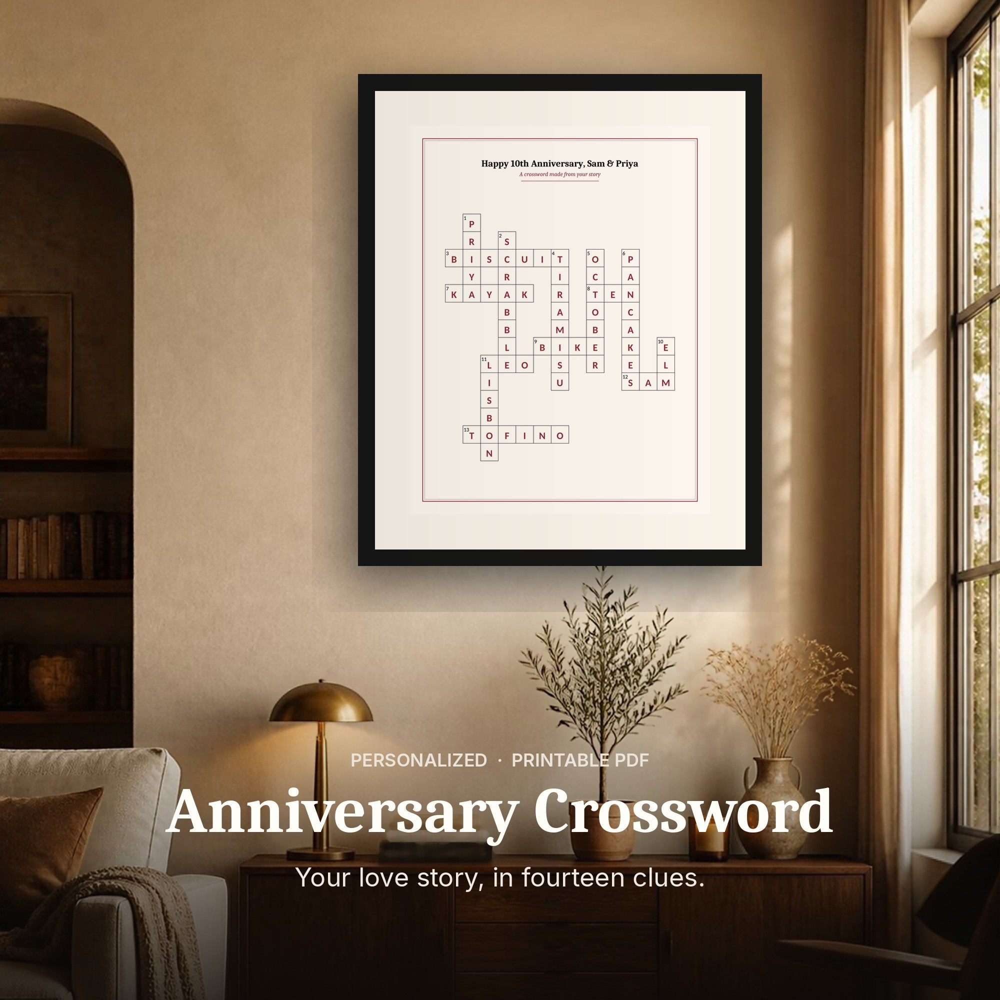
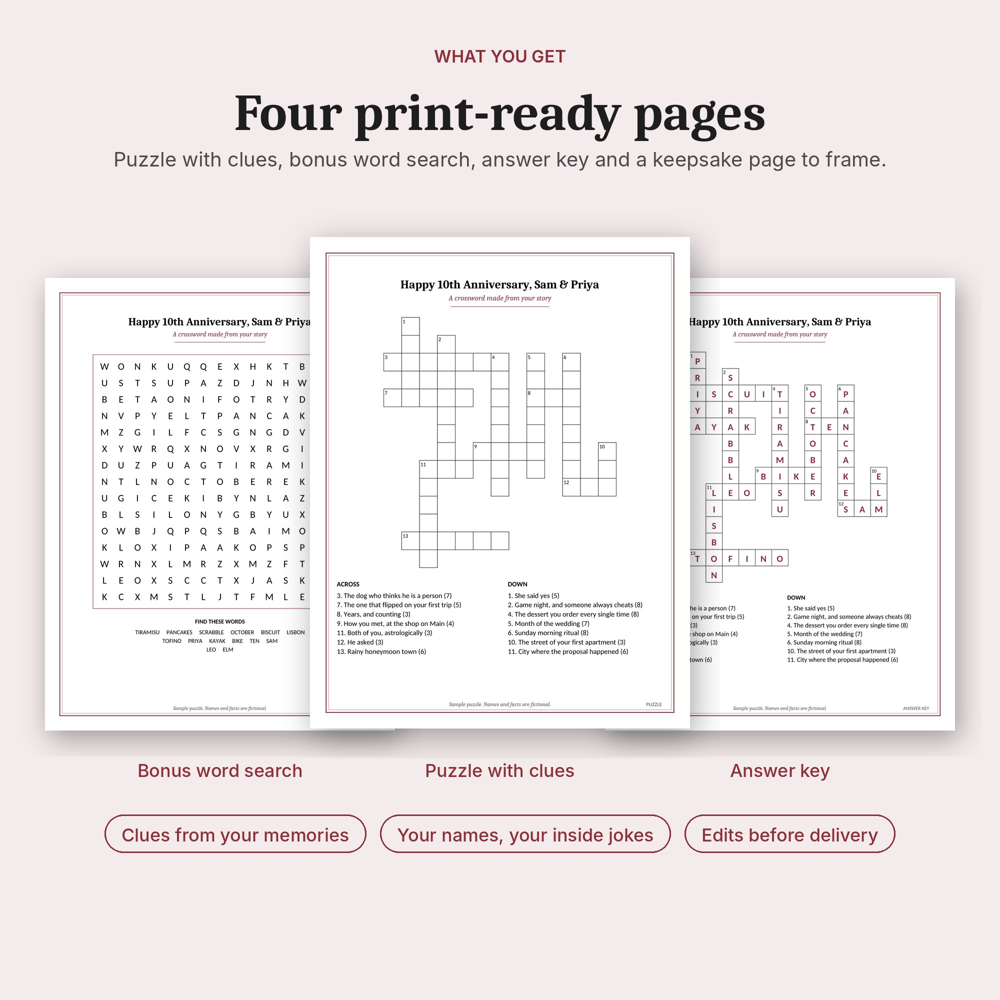

# Crossword gift generator

Turn a paragraph of memories about someone into a printable, personalized crossword puzzle. The clues are written by a small open-weight model (Gemma 3 4B through Ollama) running on your own machine, so nothing you write about your family leaves your computer.

Two scripts:

- `clues.py` reads the memories, asks the local model for answer words and clues, and validates them (letters only, 3 to 15 letters, no duplicates, no answer hidden in its own clue, and every answer must actually appear in the memories).
- `crossword.py` lays the entries out on a grid and renders a print-ready PDF: puzzle page, clues page, optional word search, solutions page. Deterministic for a given order, so re-runs reproduce the same grid.





## Quick try (no model needed)

```
git clone https://github.com/habsology/crossword-gift-generator
cd crossword-gift-generator
pip install -r requirements.txt
python3 clues.py samples/anniversary-memories.txt order.json --title "Happy 10th Anniversary" --mock
python3 crossword.py order.json puzzle.pdf
```

On Windows use `py` instead of `python3`. Needs Python 3.10 or newer. `--mock` does not use a model: it picks capitalized words from your text (names, places, pets) and writes fill-in-the-blank clues from the sentence each one came from ("Sam proposed in ____"). That proves the pipeline and the PDF work. For warmer, more specific clues, set up the local model below.

## Setup for real clues (Ollama and Gemma)

The clue writer is a small AI model that runs on your own computer, so your memories never leave it. Two pieces: **Ollama** is the free app that runs models, and **Gemma 3 4B** is the model it runs. This project only needs Ollama to be running; there is nothing to configure between them.

1. Install Ollama from https://ollama.com/download
   - Windows: run the downloaded installer (or `winget install Ollama.Ollama`)
   - macOS: open the downloaded app (or `brew install ollama`)
   - Linux: `curl -fsSL https://ollama.com/install.sh | sh`
2. Download the model once (about 3.4 GB), in a terminal or PowerShell:
   ```
   ollama pull gemma3:4b
   ```
3. Check that it is there: `ollama list` should show `gemma3:4b`.
4. Make sure Ollama is running. The Windows and macOS apps start it in the background (look for the llama icon in the tray or menu bar). On Linux, or if in doubt, run `ollama serve` in a separate terminal and leave it open.

It runs on an 8 GB GPU or on CPU only (slower).

### How the two connect

Ollama listens on `http://localhost:11434`. `clues.py` sends the memories to that address and reads back the clues. That is the default, so there is nothing to wire up. If Ollama is on another machine, or you want a different model or another OpenAI-compatible server, set two environment variables first:

```
# macOS / Linux
export CLUE_ENDPOINT=http://localhost:11434/v1/chat/completions
export CLUE_MODEL=gemma3:4b

# Windows PowerShell
$env:CLUE_ENDPOINT = "http://localhost:11434/v1/chat/completions"
$env:CLUE_MODEL = "gemma3:4b"
```

### Folder setup

Run everything from the project folder. A simple layout, one folder per puzzle:

```
crossword-gift-generator/
  clues.py, crossword.py        the two scripts
  orders/
    sam-priya/
      memories.txt              your paragraph, saved as UTF-8 plain text
      order.json                written by clues.py (edit it by hand if you like)
      puzzle.pdf                written by crossword.py
```

```
mkdir -p orders/sam-priya      # Windows PowerShell: mkdir orders\sam-priya
python3 clues.py orders/sam-priya/memories.txt orders/sam-priya/order.json --title "Happy 10th Anniversary, Sam & Priya"
python3 crossword.py orders/sam-priya/order.json orders/sam-priya/puzzle.pdf
```

`orders/` is ignored by git, so personal memories are never committed.

### If it does not work

- "Could not reach the model": Ollama is not running. Start the app or run `ollama serve`.
- Model not found: run `ollama pull gemma3:4b` again, and check `ollama list` matches `CLUE_MODEL`.
- First run is slow or seems stuck: the model is loading into memory. The first time can take a minute or two; later runs take seconds.

## Usage

Write the memories as plain prose, one paragraph is enough:

```
Sam proposed in Lisbon. They adopted Biscuit the dog in October. Priya loves Tiramisu
and Pancakes on Sundays. Honeymoon in Tofino where the Kayak flipped. Scrabble nights.
```

Then:

```
python3 clues.py samples/anniversary-memories.txt order.json --title "Happy 10th Anniversary, Sam & Priya"
python3 crossword.py order.json puzzle.pdf          # US Letter
python3 crossword.py order.json puzzle-a4.pdf a4    # A4
```

`clues.py` prints the accepted entries, the rejected candidates with the reason, and the run time. The first call to a cold model can take a minute or more while Ollama loads it; the script sends a warm-up request first and allows 300 seconds.

To run without a model (for tests and demos), add `--mock` to the `clues.py` command.

You can also skip `clues.py` and write `order.json` by hand. See the docstring at the top of `crossword.py` for the format, or any file in `samples/`.

## Tests

```
pip install pytest pypdf
pytest
```

## Fonts and layout

Titles use Caladea and text uses Carlito; both ship in `fonts/` under the SIL Open Font License, so the PDF looks the same on Windows, macOS and Linux. The puzzle page always keeps the grid and both clue columns together: the clues are measured first, the grid is sized to the space left, and the clue text steps down a size (11.5 to 8.5 pt) if a long clue list needs it. Clue numbers are right-aligned with a hanging indent, and the letter count never wraps on its own.

## How the validation works

Small models invent words and pad lists with generic answers. `clues.py` builds the set of words in the memories (plus adjacent pairs, so "New York" becomes NEWYORK) and rejects any answer outside it. On a 4B model that turns roughly 85 percent of the raw candidates into usable entries, which is why the script asks for a few more candidates than it needs.

The three raw runs that led to that rule, with every clue the model wrote and the timings, are in [`docs/gemma-runs.md`](docs/gemma-runs.md).

## Samples

`samples/` holds fictional orders for ten occasions (anniversary, birthday, Christmas, graduation, housewarming, new baby, retirement, teacher, Valentine's, wedding) with the rendered PDFs.

## License

MIT, see `LICENSE`.
